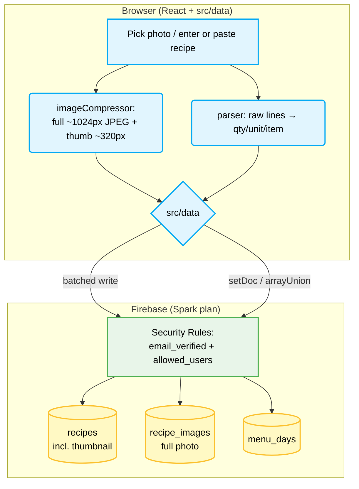

# Project Blueprint: Shared Serverless Recipe Planner

A shared recipe app and meal planner for a small, whitelisted group. It is a static React site on **GitHub Pages**, and its only backend is **Firebase** (Auth and Firestore) on the free **Spark** plan. There is no server, so all logic runs in the browser.

The decisions behind this design are in [`docs/adr/`](../adr/). This document was first drafted by Gemini, then corrected after a review in Nov 2026. The main corrections:
- Firebase Storage is no longer free (it needs Blaze since Feb 2026), so images live in Firestore.
- The Firebase config is public by design.
- The menu schema now supports any date range.

---

## Architecture

| Layer | Technology | Notes |
|---|---|---|
| Hosting | GitHub Pages, deployed by GitHub's official Pages actions | Public repo, `HashRouter`, Vite `base` = `/<repo-name>/` ([ADR-0004](../adr/0004-official-pages-actions-hashrouter.md)) |
| UI | React, TypeScript, Vite, Mantine (custom theme) | Designed for phones first. English UI, metric by default. |
| Auth | Firebase Auth, Google sign-in via `signInWithPopup` | [ADR-0003](../adr/0003-google-sign-in-popup.md) |
| Data | Cloud Firestore in `europe-west2` (London) | Offline copy on the device via `persistentLocalCache`. The region is permanent. |
| Images | Base64 JPEG stored in Firestore | No Firebase Storage ([ADR-0001](../adr/0001-images-in-firestore-not-storage.md)) |
| Security | Firestore Security Rules + an `allowed_users` collection | [ADR-0002](../adr/0002-allowlist-collection.md) |
| Development | Firebase Emulator Suite (`demo-recipe-app`) | Local-first until the Go-live epic ([ADR-0007](../adr/0007-local-first-until-go-live.md)) |

### Things that are *not* true (corrections to the original draft)

- **The Firebase web config is not a secret.** Vite bakes it into the public JavaScript bundle. The only protections are the Security Rules plus restricting the API key to the site's domains. Env vars are just for convenience.
- **Firestore does not use WebSockets.** The web SDK uses its own streaming transport. This doesn't affect the app, but don't build on the claim.
- **Free tier ≠ Storage.** Since 3 Feb 2026, any use of Cloud Storage for Firebase needs Blaze.
- **Storage download URLs would ignore the rules** (anyone with the URL can view the file). Images in Firestore are covered by the rules instead.

---

## Code structure

```
src/
  config/firebase.ts     Firebase init; connects to the emulator when VITE_USE_EMULATOR=true
  data/                  The ONLY place that imports firebase/firestore or firebase/auth
    recipes.ts           CRUD, archive, live list of active recipes
    images.ts            Compress, save and load thumbnail and full image (the migration seam)
    menu.ts              Range queries and live updates on menu_days, arrayUnion writes
    backup.ts            Export everything to JSON, restore
  utils/imageCompressor.ts   browser-image-compression: JPEG, ~1024px full / ~320px thumbnail
  parsing/               Ingredient and recipe text parsers (shared by the Pepperplate import and Quick Paste)
  components/ …          UI only; calls src/data, never Firebase directly
```

Components never call Firebase directly. Keeping it in one module puts every Firebase call in one reviewable place. It also lets tests replace Firebase with a fake, and makes a later storage move cheap.

---

## Data flow



Live updates: the recipe list and the visible range of the menu use `onSnapshot`, so a change on one device appears on the others within about a second. Firestore's offline copy shows cached data and queues writes while the device is offline.

---

## Firestore schema

`recipes` and `recipe_images` are final (Epic 2, enforced by `firestore.rules`). `menu_days` is still illustrative until Epic 5.

```jsonc
// recipes/{id}   id = kebab-case of the Pepperplate file name for imported recipes, auto ID otherwise
{
  "title": "15 Min Pulled Oats & Mushroom Pasta",   // non-empty
  "description": "",                         // imported Notes are added after a blank line
  "source": "", "sourceUrl": "",
  "yield": "", "activeTime": "", "totalTime": "",   // free text, as written
  "tags": ["pasta"],                         // lowercase
  "ingredients": [
    { "raw": "400 g Pasta (Clam shaped)", "qty": 400, "unit": "g", "item": "Pasta (Clam shaped)" },
    { "header": "For the sauce" },
    { "raw": "1-2 cloves garlic", "qty": 1, "qtyMax": 2, "unit": "clove", "item": "garlic" },
    { "raw": "Salt & pepper", "item": "Salt & pepper" }
  ],
  "instructions": [ { "text": "Boil pasta until al dente and drain" }, { "header": "While pasta is boiling" }, { "text": "…" } ],
  "thumbnail": "data:image/jpeg;base64,…",   // ~15–40 KB, at most 60,000 characters, or null
  "hasImage": true,                          // full image is in recipe_images/{same id}
  "archived": false,                         // archive instead of delete; the rules deny deletes
  "createdAt": "<timestamp>", "updatedAt": "<timestamp>"
}

// recipe_images/{recipeId}
{ "data": "data:image/jpeg;base64,…" }        // ~100–300 KB, at most 900,000 characters (document limit 1 MiB)

// menu_days/{YYYY-MM-DD}
{ "entries": [ { "recipeId": "abc123", "slot": "dinner" } ] }

// allowed_users/{email}   (edited by hand in the console; never in the repo)
{ }
```

Rules of thumb:
- If two people edit the same recipe at once, the last save wins.
- Menu entries are added with `arrayUnion`.
- Use `serverTimestamp()`, not ISO strings written by the browser.

---

## Free-tier budget (Spark)

| Quota | Limit | Expected use |
|---|---|---|
| Firestore storage | 1 GiB | ~200 recipes × up to ~450 KB (base64 full image + thumbnail) ≈ 90 MB at most |
| Reads | 50,000/day | ~200 per app open (recipe list) plus full images on demand |
| Writes | 20,000/day | Tiny. The one-off import is ~400. |
| GitHub Pages | 1 GB site, ~100 GB/month soft limit | Tiny |

If a quota runs out, the app stops until the daily reset. Nothing gets billed, because there's no billing account.

---

## Security model

- Everyone signs in with Google. The rules require `request.auth.token.email_verified == true` **and** a document at `allowed_users/{email}`.
- Each collection gets its own explicit rule. There's no `{document=**}` catch-all, so members can't add themselves or others to `allowed_users`.
- The API key is restricted (in Google Cloud Console) to `<user>.github.io` and `localhost`.
- Rules are tested automatically against the emulator in CI.

The rules text is in [project-setup.md](project-setup.md).

---

## Backups

Firestore on Spark has no point-in-time recovery or scheduled backups. The app has an **"Export everything"** button that downloads one JSON file of recipes, images and menus, and the importer can restore from it. Run an export before risky changes. The Pepperplate originals in `docs/pepperplate-data/` are a last-resort copy of the seed data.
